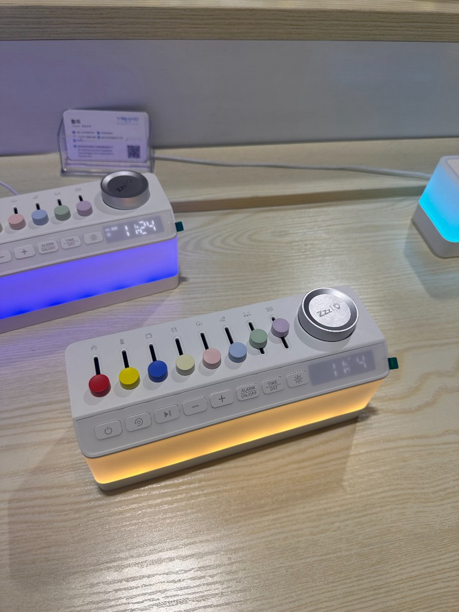
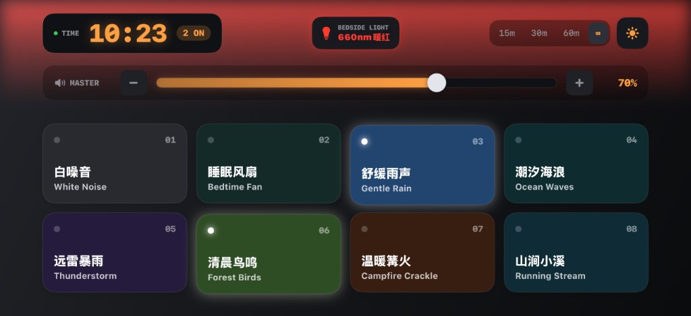

# SleepSound 纯软件拟物化台式助眠终端

> 一款专为 iPhone / iPad 横屏床头打造的极简拟物化助眠声学应用。融合了高品质多轨声学内容与实体桌面音响的物理交互质感，支持后台锁屏播放与线性马达触觉反馈。

---

## 💡 灵感来源与实机对比

本项目的 Idea **直接来源于图 1 中的实体助眠硬件（远光浩 YGHAO 多推子床头音箱原型）**。我们通过软硬件跨界思维，汲取了其多色彩色实体推子、床头夜灯与台式钟的经典形态，在 iOS 原生端重构为图 2 中的纯软件极简拟物化体验：

| 图 1：灵感来源 · 实体硬件原型 | 图 2：iOS 原生实现 · 实机运行截图 |
| :---: | :---: |
|  |  |
| *远光浩（YGHAO）经典 8 推子实体助眠硬件原型* | *SleepSound iOS 原生横屏沉浸实测运行* |

---

## 📖 项目描述

**SleepSound** 致力于解决传统白噪音 App 的“数码冰冷感”与“屏幕蓝光干扰”，将手机转变为一台温润、沉浸、拥有实体机械触感的床头助眠音响。

### 核心亮点

1. **三层黄金比例横屏控制台 (Landscape Bedside Console)**
   - 专为手机横屏与床头支架场景设计，机身材质贴满整块屏幕，四周内圈智能避让灵动岛与前置摄像头，左右完全对称居中。
   - **第 1 层**：极简下沉点阵时钟 + 运行状态胶囊 + 居中床头氛围夜灯 + 4 档睡眠定时器（15m / 30m / 60m / ∞）与双主题切换。
   - **第 2 层**：独立大尺寸主音量控制台，支持全触控宽屏滑道平滑拖动与实体 `[-]` / `[+]` 5% 步进微调。
   - **第 3 层**：8 颗大尺寸实体彩色微动琴键，纵向自适应撑满下半屏，彻底消除闲置空白。

2. **8 种物理生成式自然声波 (Procedural Sound Engine)**
   彻底告别传统白噪音单一过滤的嘶嘶杂音，为 8 种声音全部编写了独立的数学物理声学模型：
   - 🐦 **清晨鸟鸣 (Forest Birds)**：森林微风沙沙基底，注入真实的调频扫频正弦波鸟啼（2.7kHz ~ 4.7kHz），婉转起伏、清脆甜美。
   - 🔥 **温暖篝火 (Campfire)**：温润低频火焰轰鸣 + 随机木炭清脆爆裂脉冲（Charcoal Crackles & Pops）。
   - 💧 **山涧小溪 (Stream)**：潺潺水流基底 + 灵动气泡翻滚破裂音（Bubble Pinch-off）。
   - ⚡ **远雷暴雨 (Thunderstorm)**：倾盆暴雨背景 + 55Hz 极低频滚滚闷雷，真实回荡衰减。
   - 🌊 **潮汐海浪 (Ocean Waves)**：8.5 秒自然呼吸周期的浪涌波律、拍岸浪花白沫与深长退潮。
   - 💨 **睡眠风扇 (Fan)**：60Hz/120Hz 沉稳低频电机 + 1.0Hz 舒缓慢速扇叶旋转气流（每分钟 60 转呼吸级慢速催眠送风）。
   - 🌧️ **舒缓雨声 (Rain)**：致密水汽雨声 + 随机细密雨滴打击微瞬态。
   - ⚪ **白噪音 (White Noise)**：平滑纯净的高斯全频平直噪音。

3. **等功率交叠无缝循环引擎 (Equal-Power Seamless Looping)**
   - 针对传统音频切片循环时容易出现的“停顿、卡顿、音量瞬间下陷”的痛点，升级为**数学等功率三角交叠算法（Equal-Power Overlap-Add Crossfade）**。
   - 尾部与头部以 $\sin^2(\theta) + \cos^2(\theta) = 1.0$ 的能量守恒权重平滑交叠，接缝处总声能恒定，**100% 连贯平滑，永不停顿**。

4. **自由多选叠加混音 (Multi-Stacking)**
   - 允许用户同时点亮 1 至 8 种声音（例如：雨声 + 篝火 + 远雷）。
   - 底层音频引擎自动进行动态裕量平衡（Headroom Management），确保多轨叠加时层次分明、绝不爆音失真。

5. **床头氛围夜灯与节律光疗 (Circadian Night Light)**
   - **超广域漫射光晕**：点亮后屏幕上半部向下投射深层漫射柔光，真实照亮床头柜。
   - **慢节奏呼吸引导**：内置约 3.5 秒周期的柔和呼吸明暗波动，辅助放缓呼吸节律。
   - **科学光谱档位**：
     - 🔴 **660nm 暖红**：医用级窄带红光，深度助眠，不刺激视网膜，保护褪黑素自然分泌。
     - 🟠 **夕阳琥珀**：1800K 温馨落日暖光，起夜伴睡。
     - 🌙 **关闭**：纯黑节电。

6. **系统级 Taptic Engine 触觉体系**
   - 琴键下压触发 18ms 物理微动开关确信震动（`UIImpactFeedbackGenerator(.medium)`）。
   - 音量滑道滑动触发高频微齿轮滚珠跳格震动（`UISelectionFeedbackGenerator`）。
   - 夜灯与主题切换触发两段式硬朗卡扣震动。

7. **日间纯白 / 夜间钛黑双主题自适应**
   - **日间纯白**：致敬 Braun / MUJI 极简纯白家居美学，搭配复古彩色琴键。
   - **夜间钛黑**：深色钛金属质感，支持 OLED 纯黑沉浸，夜间彻底防刺眼。

8. **后台常驻锁屏播放**
   - 配置系统级 `AVAudioSession(.playback)`，息屏锁屏、切入后台均可平稳持续发声。

---

## 📁 结构概览

```text
/Users/zhangbin/workspace/sleepsound/
├── assets/                       # 灵感原型与应用实测图片
│   ├── hardware_prototype.jpg    # 图 1：远光浩 YGHAO 实体助眠硬件原型
│   └── app_landscape_ui.jpg      # 图 2：SleepSound 原生横屏实测界面
├── SleepSound.xcodeproj          # ⭐️ Xcode 主工程入口 (快捷方式)
├── S670SleepSound.xcodeproj      # Xcode 原生项目包
│   ├── project.pbxproj           # 项目配置文件 (已配置签名与编译管线)
│   └── project.xcworkspace       # 工作区配置
├── S670SleepSound/               # 原生 Swift 源码目录
│   ├── ContentView.swift         # 纯净三层台式控制台 UI (自适应避让摄像头、已去底标)
│   ├── AudioEngine.swift         # 8 种声音物理数学合成器与等功率无缝混音引擎
│   ├── HapticManager.swift       # Taptic Engine 线性马达触觉标定管理器
│   ├── S670SleepSoundApp.swift   # 应用入口与后台音频会话激活配置
│   └── Info.plist                # 显示名称「SleepSound」与后台音频权限
├── docs/                         # 产品设计与规范文档
│   ├── virtual_sound_machine_app_prd.md  # 软件拟物化完整设计规范书 (PRD)
│   ├── next_gen_sleep_sound_prd.md       # 软硬一体化产品架构设计书
│   └── skeuomorphic_sound_machine.html   # 可交互拟物原型组件 (Web Audio 实时试听)
└── README.md                     # 本说明文档
```

---

## 🚀 运行方式

### 环境要求
- 电脑：macOS Monterey / Ventura / Sonoma / Sequoia
- 开发工具：Xcode 14.0 或更高版本
- 真机支持：运行 iOS 16.0 及以上系统的 iPhone / iPad

### 第 1 步：用 Xcode 打开项目
在 Mac 终端中运行以下命令：
```bash
open /Users/zhangbin/workspace/sleepsound/SleepSound.xcodeproj
```

### 第 2 步：配置免费个人签名 (仅首次需要)
1. 在 Xcode 左侧项目导航器中点击最上方的蓝标 **S670SleepSound**；
2. 选择 **Signing & Capabilities** 标签页；
3. 在 **Team** 下拉框中，选择你的个人 Apple ID（Personal Team，完全免费）；
4. 项目已配置专属 Bundle Identifier：`com.zhangbin.s670sleep`，Xcode 将自动联网生成 Provisioning Profile 并打上绿色对勾。

### 第 3 步：真机编译与安装
1. 使用数据线将 iPhone 连接到 Mac；
2. 在 Xcode 窗口顶部居中的设备选择器中，点击选中你的真实 iPhone（如设备 `IAMSK`）；
3. 点击左上角 **运行按钮（▶️）**（或按快捷键 `Cmd + R`）。

Xcode 将自动完成编译并在约 10 秒内将应用安装至你的 iPhone！

---

## 💡 首次安装特别提示

如果在手机上首次点击应用图标弹出安全提示，只需按以下步骤操作：

1. **信任证书**：进入 iPhone「设置」→「通用」→「VPN 与设备管理」，在开发者 App 下点击你的 Apple ID，选择 **“信任”**；
2. **开启开发者模式**（iOS 16+ 首次真机调试要求）：
   - 进入 iPhone「设置」→「隐私与安全性」；
   - 滑动到最底部，进入「开发者模式」并将其开启；
   - 按照屏幕提示重启手机即可正常使用。
