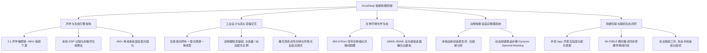
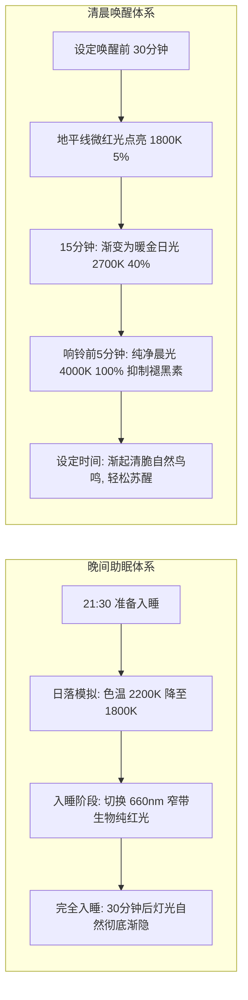
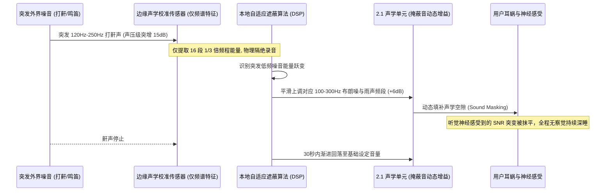
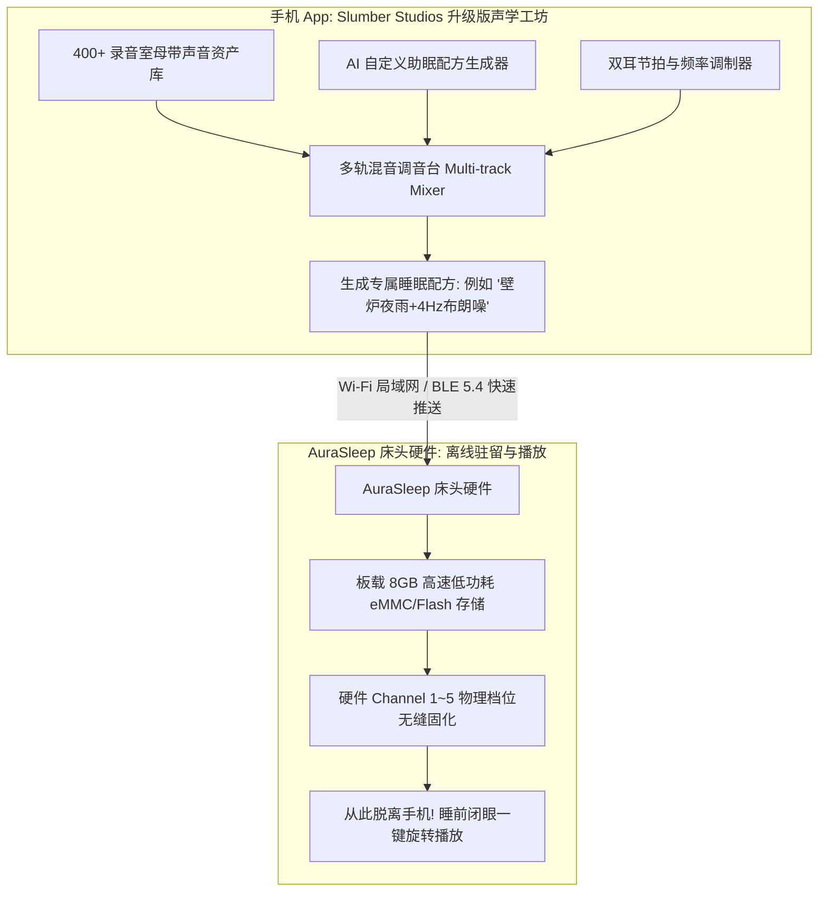
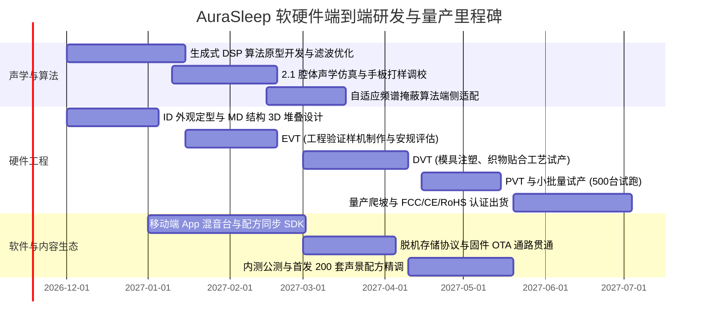

# 下一代智能声学生物节律助眠终端：产品设计方案与系统规格书
**代号：AuraSleep（灵境之声）**
*从 Slumber Studios App 与 YGHAO S670 出发的软硬协同突破*

---

## 1. 现状解构与跨界破局机会

### 1.1 两款标杆产品深度优缺点对比

| 评估维度 | 软件标杆：White Noise Deep Sleep Sounds (Slumber Studios) | 硬件标杆：YGHAO S670 白噪音机 | 传统方案痛点 |
| :--- | :--- | :--- | :--- |
| **载体与形态** | 智能手机 App（iOS/Android） | 独立床头硬件（塑胶机身、物理按键） | 手机带来“卧室数字污染”；传统硬件外观廉价、无生态 |
| **声音库与内容** | 400+ 丰富声景、色彩噪音、双耳节拍、多轨混音 | 仅 8~24 种出厂固化循环音频（ROM芯片存储） | App内容虽多但无法脱离手机；硬件内容极度匮乏且死板 |
| **声学与音质表现** | 受限手机微型扬声器，**缺乏低频下潜**（布朗噪发干发尖） | 双扬声器但腔体简陋，高音刺耳、低频共振浑浊 | 无法真实还原雷雨低鸣、粉噪与深层布朗噪的松弛包裹感 |
| **循环与听感疲劳** | 优质无缝循环，但长时间听仍有“机械重复潜意识感知” | **短循环明显**，循环衔接点有卡顿/底噪跳变，易惊醒浅眠者 | 人类大脑对重复模式极度敏感，循环音频反而容易导致烦躁 |
| **床头交互体验** | 强光屏操作，蓝光抑制褪黑素；易受微信/消息推送分心 | 密集小塑料按键，夜间完全无法盲操；廉价LED常亮刺眼 | 睡前与半夜醒来时的交互体验极差，破坏入睡心境 |
| **环境自适应能力** | 无（固定音量播放，对外界半夜打鼾、鸣笛毫无防御） | 无（机械被动发声） | 无法根据外界突发刺耳噪音（打鼾、关门声）智能补偿遮蔽 |
| **光疗与节律支持** | 无硬件光照能力 | 简单普通 RGB 氛围灯，缺乏医用级光谱设计 | 劣质蓝光/冷白光严重干扰人体昼夜节律与褪黑素分泌 |
| **商业与变现模式** | 年订阅制（约 $39.99~$59.99/年），用户续费疲劳感重 | 一次性硬件销售（低毛利硬件白牌战，$20~$35） | App续订率逐年衰退；硬件沦为代工贴牌低价竞争 |

```mermaid
quadrantChart
    title 白噪音产品市场定位与破局象限
    x-axis 声音内容与算法丰富度 (低 --> 高)
    y-axis 床头声学与物理脱机体验 (低 --> 高)
    quadrant-1 我们的破局点: AuraSleep (软硬一体+生成式声学)
    quadrant-2 传统硬件: YGHAO S670 / 白牌机
    quadrant-3 简易白噪音玩具 / 廉价小音箱
    quadrant-4 纯软件: Slumber Studios / 潮汐 / Endel
    "YGHAO S670": [0.25, 0.70]
    "Slumber Studios": [0.85, 0.25]
    "Hatch Restore 2": [0.65, 0.85]
    "AuraSleep (目标产品)": [0.92, 0.95]
```

### 1.2 核心破局价值主张 (Value Proposition)
将 Slumber Studios 的 **“无限混音与高维度声音资产”** 与 S670 的 **“床头独立驻留与脱机声学载体”** 深度融合，并通过三项革命性技术实现降维打击：
1. **声学升维**：由“预录音频循环（Recorded Loops）”升级为“**本地神经生成式非循环音频（Procedural Generative Sound）**”+ 定制 2.1 长冲程微声学腔体。
2. **交互升维**：彻底告别手机屏幕，采用**天然织物触控 + 双高阻尼拟物化机械调音旋钮 + 隐形点阵微孔冷光显影**，实现真正的“数字排毒（Digital Detox）”与闭眼盲操。
3. **环境与节律升维**：引入 **边缘声学校准麦克风（自适应频谱噪音掩蔽）** 与 **660nm 褪黑素赋能生物红光/自然晨曦日出系统**。

---

## 2. 目标用户画像与核心使用旅程

```mermaid
journey
    title 典型失眠/浅眠用户的夜间全流程体验 (AuraSleep vs 传统方案)
    section 睡前准备 (22:30)
      传统方案 (手机App): 3: 打开手机被微信/短视频吸走30分钟，屏幕蓝光刺激
      AuraSleep: 5: 走进卧室，轻触顶部织物唤醒 660nm 暖红日落光，物理旋钮一拧即播
    section 入睡引导 (23:00)
      传统方案 (S670硬件): 2: 塑料按键咔嗒响，声音短循环产生机械烦躁感
      AuraSleep: 5: 沉浸式非循环布朗噪+远山细雨，低音深沉温润，无任何循环痕迹
    section 深夜突发噪音 (02:15)
      传统方案: 1: 伴侣打鼾/窗外汽车鸣笛，被惊醒并难以再次入睡
      AuraSleep: 5: 麦克风毫秒级感应突发噪音频谱，无感微调对应频段掩蔽音量，平滑抹除噪音冲击
    section 清晨唤醒 (07:00)
      传统方案: 2: 刺耳急促的手机闹铃惊醒，心跳加速，皮质醇骤升
      AuraSleep: 5: 提前30分钟色温自 1800K 晨曦平滑过渡至 4000K，伴随微风森林渐响鸟鸣自然苏醒
```

---

## 3. 产品架构与五大核心创新系统



---

### 3.1 创新维度一：声学架构与过程化生成式音频引擎 (Procedural Sound Engine)

#### (1) 声学硬件系统定义（解决手机和廉价机“破、薄、扁”的音质痛点）
* **微型 2.1 声学腔体布局**：
  * **主低音单元**：1 × 2.25 英寸长冲程定制跑道型低音扬声器 + 双向对称无源被动辐射板（Dual Passive Radiators）。
  * **高/全频单元**：2 × 1.5 英寸钕铁硼高灵敏度全频单元，对称双向微角扩散（角度 15° 向外偏角），营造宽广的床头立体声场。
  * **声学响应指标**：有效频宽达到 **48 Hz – 20,000 Hz**（普通白噪音机如 S670 通常在 150 Hz 就大幅截断衰减）。
  * **声学价值**：只有下潜到 50Hz 以下，**布朗噪音（Brown Noise）、暴风雨低鸣、深海潜水** 的物理共鸣才能真正激活副交感神经，消除听觉毛躁感。

#### (2) 过程化生成算法（Procedural Generative Audio）
* **彻底告别音频循环（Loop-Free）**：
  * 传统 S670 是将 10~30 秒的 WAV/MP3 烧录进 Flash 循环播放；Slumber Studios App 虽长，但依然是固定音频段切片。
  * AuraSleep 在板载定制 DSP（如 ADI SigmaDSP 或 Tensilica HiFi DSP）上运行轻量数学模型：
    * **颜色噪音**：通过实时白高斯噪声发生器 + 可配置多阶极零点 IIR 数字滤波器（实时生成真正平滑的 1/f 白、粉、布朗、绿、蓝噪）。
    * **自然水声**：利用元胞颗粒合成（Granular Synthesis）实时解算雨滴撞击频率与水流混沌流体方程，雨滴密度、风力扰动每秒都在发生微积分变化，**永远不出现同一声波曲线**。
    * **脑波协同**：硬件底层原生支持载波频率混合生成 **4Hz（Theta波 - 深度冥想）** 与 **2Hz（Delta波 - 深度慢波睡眠）** 双耳节拍（Binaural Beats）与等时音（Isochronic Tones）。

---

### 3.2 创新维度二：去屏幕化工业设计与无感盲操交互

#### (1) 外观形态与材质（Carging & Materials）
* **外观语言**：圆润鹅卵石梯形截面，与人体视线形成自然倾角，避免传统圆柱塑料闹钟的工模感。
* **材质组合**：
  * 外部包裹：声学透声定制无缝亚麻混纺织物（温暖柔和，消解数码科技冷感）。
  * 顶盖面板：亲肤哑光防污涂层触控区 + 阳极氧化铝合金精雕旋钮（带有微段落机械阻尼）。

#### (2) 物理操控逻辑（专门解决半夜摸索痛点）
* **左旋钮（Volume & Power）**：
  * 阻尼顺滑旋转调音，下压按击开关机。
  * 具备智能渐变曲线：旋转音量调整时，声音平滑过渡（Fade in/out 300ms），绝无破音骤变。
* **右旋钮（Sound Blend / Mood Selector）**：
  * 无缝混合双轨声景。例如默认模式下：顺时针旋转提升“自然元素（如雷雨）”占比，逆时针旋转提升“纯净布朗底噪”占比。
  * 旋转切换 5 组预设场景，伴随柔和的提示微光切换。
* **顶盖织物全域轻拍（Tap Anywhere）**：
  * 半夜迷糊时无需找具体按键，**整手轻拍机器顶部**即激活微弱地脚夜灯（1%亮度红光，刚好照亮拖鞋，完全不刺眼）。再次轻拍关闭。

#### (3) 隐形点阵微孔冷光显影（Invisible-until-lit）
* 显示屏隐藏在正面织物内部，不点亮时完全隐形，呈现纯粹家居美学。
* **超微弱暖白/琥珀色点阵**显示时间与状态。
* **环境光传感器（ALS）联控**：室内关灯 60 秒后，显示自动淡出至完全熄灭（100%全黑卧房），或保持 0.5% 极限微光（根据用户 App 设置）。

---

### 3.3 创新维度三：生物节律光学生态 (Circadian Rhythm Light)

区别于 S670 的廉价 RGB 跑马灯，AuraSleep 引入精准医疗级节律照明：



* **650-670nm 窄带红光**：物理波长不刺激视网膜固有自感光神经节细胞（ipRGC），阻断蓝光神经兴奋，促进松果体天然褪黑素合成。
* **日落呼吸助眠（Wind-down Breathing Guide）**：灯光配合 4-7-8 呼吸节律缓慢明暗起伏（吸气4秒、屏息7秒、呼气8秒），引导心率自然回落。
* **双通道灯带架构**：内环高显指 Ra>95 全光谱暖白 LED + 外环专业波长 660nm 医用级红光 LED。

---

### 3.4 创新维度四：边缘智能自适应掩蔽系统 (Smart Spectral Masking)

针对城市公寓与家庭常见痛点：**半夜伴侣鼾声、隔壁邻居开关门声、楼上高跟鞋声、马路突发鸣笛**。



* **严格的隐私底线保障**：
  * 板载麦克风信号不经过系统主 CPU，只接入独立音频传感 DSP；
  * 本地只进行 FFT 频域能量积分运算（16-band energy spectrum），**无任何音频录制、存储、网络传输能力**；
  * 配备物理硬件防拾音开关与状态微孔指示灯，彻底解除卧室隐私疑虑。

---

### 3.5 创新维度五：软硬协同内容闭环（将 Slumber Studios 搬到床头）

AuraSleep 绝非与 App 脱节的孤立硬件，而是 **“手机做创作工坊，硬件做终极沉浸播放器”**：



* **离线配方注入（Offline Preset Injection）**：
  * 用户在 App 里随心所欲调好喜欢的混音（例如：雨声 40% + 远雷 20% + 帐篷拍打 15% + 4Hz 双耳节拍 25%）。
  * 点击“同步至床头机”，硬件本地直接离线固化。
  * **日常使用完全不需要连接手机、不需要开蓝牙推流，彻底消灭电池消耗、蓝牙断连、手机发烫与辐射担忧**。

---

## 4. 详细硬件与电气系统规格书

| 模块系统 | 核心元器件与规格配置 | 选型与工程考量 |
| :--- | :--- | :--- |
| **主控芯片 (MCU/SoC)** | 乐鑫 ESP32-S3 双核 240MHz (或 恒玄 BES2600 智能音频芯片) | 集成 Wi-Fi 4/6 + BLE 5.4，低功耗待机，自带轻量 Vector 指令加速 |
| **数字音频处理器 (DSP)** | ADI ADAU1761 / TI TAS5805M (内置数字功放与可编程 DSP) | 负责硬件级 PEQ 曲线调校、DRC 动态动态范围压缩、非循环噪音合成 |
| **功放与扬声器** | 20W Class-D 双通道高效低发热数字功放<br>• 1 × 2.25" 10W 长冲程低音单元<br>• 2 × 1.5" 5W 钕铁硼全频单元<br>• 对称无源双低音辐射板 | 在 1.2L 紧凑机身内释放 48Hz 低频，失真率 THD+N < 0.5% (80Hz-15kHz) |
| **光疗照明模组** | 36 颗高显指（Ra>95）双色温 RGBCW LED + 12 颗专用 660nm 窄带生物红光 LED | 搭配扩散级 PC 导光罩与微棱镜反射膜，实现无颗粒、无眩光的如玉光感 |
| **本地存储** | 4GB / 8GB 高可靠性 eMMC 或 SPI NAND Flash | 可在离线状态存储超过 50 套无损级声景配方与生成式参数模型 |
| **传感器配置** | • 数字微型环境光传感器 (ALS)<br>• 高信噪比低底噪模拟微机电麦克风 (仅频域分析)<br>• 顶盖全表面电容式轻拍传感器 | 实现自动熄屏、外界噪音监测与床头无感轻拍地灯 |
| **网络与连接** | 2.4G/5GHz 双频 Wi-Fi + 蓝牙 5.4 (支持 LE Audio 与 LC3 编解码) | 支持蓝牙音箱模式（AirPlay/Cast可选）、App快速局域网配网与配方烧录 |
| **供电方案** | USB-C 接口供电 (PD 9V/2A 或 12V/1.5A)；内置 3.7V/5200mAh 备用锂电池 | 满足停电时持续发声与闹钟唤醒 12 小时以上，支持出差旅行便携使用 |

---

## 5. 商业化路径与经济效益分析 (BOM & Business Model)

### 5.1 硬件 BOM 成本估算模型 (基于 50K 量产规模)

| 构成项目 | 预估成本 (USD) | 备注说明 |
| :--- | :--- | :--- |
| 主控 SOC + DSP + 射频模块 (ESP32-S3 + TAS5805M) | $4.80 | 成熟高性价比方案 |
| 声学扬声器 + 无源辐射板 + 定制密封微腔 | $5.50 | 决定听感质感的核心溢价部件 |
| 光疗 LED 灯珠板 + 导光扩散罩体系 | $2.80 | 高显指双色温 + 660nm 医用级红光 |
| 外观注塑件 + 定制透声织物网布 + CNC 铝旋钮 | $4.50 | 打造 $100+ 级别北欧高端家居质感 |
| 传感器 (ALS、MEMS 麦克风、电容触控) | $1.20 | 关键自适应体验支撑 |
| 5200mAh 电池与充放电保护电路板 | $3.50 | 停电应急与便携使用 |
| 电源适配器 (USB-C 18W) + 编织电源线 | $1.80 | 保证开箱即用 |
| 结构辅料、螺丝、密封发泡胶、彩盒包装及说明书 | $2.40 | 环保高端礼盒级包装 |
| **整机预估硬件 BOM 成本 (FOB)** | **~$26.50** | 远高于 S670 ($6-8)，但远低于传统高端音箱 |

### 5.2 市场定价与竞品定位

* **市场零售定价（MSRP）**：**$89 - $129**
  * 相比 **S670 / 白牌机 ($25 - $39)**：音质、外观、交互与健康科学性全面碾压，切入新中产卧室消费升级。
  * 相比 **Hatch Restore 2 ($199 + $49/年强制订阅)**：AuraSleep 性能更强、低频更沉、买断制核心功能免除强制月费反感，具备极强价格优势与诚意。

### 5.3 混合商业模式 (Hybrid Hardware + Ecosystem)
1. **硬件基础买断（核心功能全免费）**：
   * 购机即永久享有 80+ 种高品质声景、所有色彩噪音生成算法、全套日落红光与日出唤醒功能。杜绝让用户感到“买了机器还要按月交保护费”的恶劣体验。
2. **AuraSleep Plus 会员增值服务（可选订阅 $29.99/年）**：
   * **名家内容生态**：与著名睡眠神经学专家、冥想大师联名引导式冥想、睡前催眠故事、专属白噪音定制母带。
   * **云端自适应智能洞察**：结合睡眠周期统计生成个人听觉敏感度分析报告。
3. **品牌与场景周边延伸**：
   * 可替换磁吸声学织物面罩（不同季节材质/家居配色，客单价 $15）。
   * 差旅便携防震硬壳保护包。

---

## 6. 研发落地路线图与里程碑 (Roadmap)


